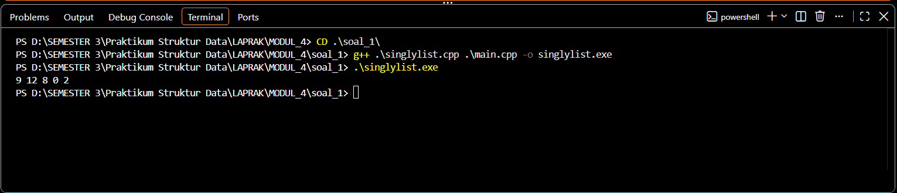
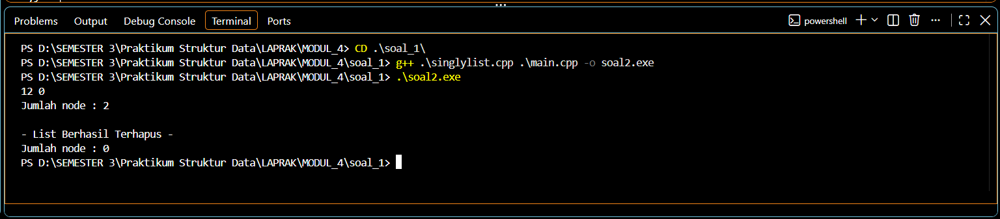

# <h1 align="center">Laporan Praktikum Modul 4 - Singly Linked List (Bagian Pertama)</h1>
<p align="center">AHMAD LUTHFI HABIBIE - 109082500190</p>

## Dasar Teori

### A. Singly Linked List<br/>
Linked list (biasa disebut list saja) adalah salah satu bentuk struktur data berupa serangkaian elemen data yang saling berkait dan bersifat fleksibel karena dapat tumbuh dan mengerut sesuai kebutuhan. Data yang disimpan bisa berupa data tunggal (misalnya `int`) maupun data majemuk berupa *record* (misalnya data mahasiswa yang terdiri dari nama, NIM, dan umur) [1]. Singly Linked List adalah model linked list yang hanya memiliki satu arah pointer, yaitu setiap *node* hanya menyimpan satu pointer ke *node* berikutnya [1][4]. Karena memiliki satu pointer saja, penelusuran hanya dapat dilakukan maju dari *node* pertama hingga *node* terakhir [1][4].

#### 1. Komponen dan Istilah pada Singly Linked List
Setiap elemen pada Singly Linked List terdiri dari bagian data (informasi utama yang disimpan) dan bagian *successor* (penghubung ke elemen berikutnya). Beberapa istilah yang dipakai antara lain `first/head` yaitu pointer yang menunjuk alamat elemen pertama list, `next` yaitu pointer pada elemen yang berfungsi sebagai penunjuk alamat elemen di depannya, `Nil/NULL` yaitu nilai yang tidak mengacu ke mana pun (menandai akhir list atau list kosong), serta *node* yaitu tempat penyimpanan data pada memori tertentu. *Node* terakhir selalu menunjuk ke `Nil` kecuali pada list *circular* [1]. List dikatakan kosong jika `L.first = Nil`.

#### 2. Representasi ADT Singly Linked List
Pada C++, ADT Singly Linked List diwujudkan dengan `struct` untuk elemen (berisi `info` dan `next`) dan `struct` untuk list (berisi `first`). Seperti pada ADT umumnya, kode dipisah menjadi file `*.h` yang menyimpan tipe data dan prototipe primitif, serta file `*.cpp` yang menyimpan realisasi primitif tersebut [1]. Untuk mengakses semua primitif, file `*.h` cukup di-*include* pada file yang membutuhkan.

### B. Pointer dan Alokasi Memori Dinamis<br/>
Linked list dapat diimplementasikan dengan *array* maupun *pointer*. Pointer dipilih karena *array* bersifat statis, sedangkan pointer bersifat dinamis sehingga sesuai dengan sifat linked list yang fleksibel [1]. Linked list memakai alokasi memori dinamis, yaitu memori untuk elemen baru dialokasikan hanya ketika dibutuhkan [3].

#### 1. Alokasi dan Dealokasi
Alokasi memori pada C++ dilakukan dengan `new` (pada C dengan `malloc`), sedangkan dealokasi dilakukan dengan `delete` (pada C dengan `free`) [1]. Pada ADT, kedua proses ini dibungkus dalam primitif `alokasi()` dan `dealokasi()`. Pengaksesan elemen melalui pointer dapat menggunakan operator panah (`->`) atau tanda titik (`.`) [1]. Pengelolaan pointer yang benar penting agar tidak terjadi kebocoran memori (*memory leak*) dan agar integritas list tetap terjaga.

#### 2. Operasi Insert
Operasi *insert* memasukkan elemen baru ke dalam list. *Insert First* menyisipkan di awal list dengan langkah `P->next = L.first` lalu `L.first = P`. *Insert Last* menyisipkan di akhir list dengan menelusuri sampai elemen terakhir `Q`, kemudian `Q->next = P`. *Insert After* menyisipkan setelah *node* tertentu `Q` dengan langkah `P->next = Q->next` lalu `Q->next = P` [1]. Urutan langkah pada *insert after* penting: jika `Q->next = P` dilakukan lebih dulu, sambungan ke elemen setelah `Q` akan hilang.

#### 3. Operasi Delete
Operasi *delete* melepas elemen dari list lalu mengembalikan memorinya ke sistem. *Delete First* dilakukan dengan `P = L.first`, `L.first = (L.first)->next`, dan `P->next = Nil`. *Delete Last* dilakukan dengan mencari elemen terakhir `P` dan elemen sebelumnya `Q`, kemudian `Q->next = Nil`. *Delete After* melepas *node* setelah *node* tertentu dengan `P->next = Q->next` dan `Q->next = Nil`. Setelah dilepas, elemen dikembalikan atau didealokasi dengan `dealokasi(P)` [1]. Selain itu terdapat operasi menghapus seluruh elemen list (`delAll`/`deleteList`) yang membebaskan semua memori elemen sehingga list menjadi kosong [1].

#### 4. View dan Penghitungan Elemen
*View* adalah operasi menelusuri list dari elemen pertama dan menampilkan data pada setiap *node* [1]. Fungsi `nbList` menelusuri list dengan cara yang sama tetapi untuk menghitung dan mengembalikan jumlah elemen pada list [1].

### C. Perbandingan Singly Linked List dengan Struktur Lain<br/>
Singly Linked List hanya memiliki satu pointer per *node* yang menunjuk ke *node* berikutnya, sedangkan Doubly Linked List memiliki dua pointer yaitu ke *node* sebelumnya dan berikutnya sehingga navigasi dapat dilakukan dua arah dan operasi sisip serta hapus menjadi lebih mudah dilakukan [2]. Dibandingkan *array*, linked list lebih mudah menyisipkan atau menghapus elemen di tengah list karena cukup mengubah pointer tanpa menggeser elemen lain [1], tetapi pencarian pada list yang tidak terurut harus dilakukan secara sekuensial [1].

## Guided 

### 1. list.h

```C++
//list.h
#ifndef LIST_H
#define LIST_H

#define Nil NULL

#include <iostream>
#include <string>
using namespace std;

// Deklarasi data mahasiswa
struct mahasiswa {
    string nama;
    string nim;
    int umur;
};

typedef mahasiswa dataMahasiswa;
typedef struct node *address;

// Struktur node
struct node {
    dataMahasiswa isidata;
    address next;
};

// Struktur linked list
struct LinkedList {
    address first;
};

// Deklarasi fungsi dan prosedur
bool isEmpty(LinkedList List);
void createList(LinkedList &List);
address alokasi(string nama, string nim, int umur);
void dealokasi(address &node);

void printList(LinkedList List);
void insertFirst(LinkedList &List, address nodeBaru);
void insertAfter(LinkedList &List, address nodeBaru, address Prev);
void insertLast(LinkedList &List, address nodeBaru);

void delFirst(LinkedList &List);
void delLast(LinkedList &List);
void delAfter(LinkedList &List, address nodeHapus, address nodePrev);

int nbList(LinkedList List);
void deleteList(LinkedList &List);

#endif
```
File `list.h` merupakan bagian definisi/spesifikasi type dan primitif untuk Singly Linked List dengan data mahasiswa. `#define Nil NULL` dipakai agar penulisan pointer kosong sesuai istilah pada modul. `struct mahasiswa` menyimpan `nama`, `nim`, dan `umur`, lalu di-*typedef* menjadi `dataMahasiswa` sebagai tipe info. `address` didefinisikan sebagai pointer ke `struct node`, sedangkan `struct node` berisi `isidata` (data mahasiswa) dan `next` (pointer ke *node* berikutnya). `struct LinkedList` hanya memiliki satu field yaitu `first` yang menunjuk elemen pertama list. Setelah itu dideklarasikan prototipe primitif: `isEmpty` dan `createList` untuk pengecekan dan pembentukan list, `alokasi` dan `dealokasi` untuk manajemen memori, `insertFirst`, `insertAfter`, `insertLast` untuk penambahan elemen, `delFirst`, `delLast`, `delAfter` untuk penghapusan elemen, `printList` untuk menampilkan isi list, serta `nbList` dan `deleteList` untuk menghitung dan menghapus seluruh elemen. Baris `#ifndef`, `#define`, dan `#endif` berfungsi sebagai *include guard*.

### 2. list.cpp

```C++
//list.cpp
#include "list.h"
#include <iostream>
using namespace std;

// Memeriksa apakah list kosong
bool isEmpty(LinkedList List) {
    return List.first == Nil;
}

// Membuat list kosong
void createList(LinkedList &List) {
    List.first = Nil;
}

// Membuat node baru
address alokasi(string nama, string nim, int umur) {
    address nodeBaru = new node;

    nodeBaru->isidata.nama = nama;
    nodeBaru->isidata.nim = nim;
    nodeBaru->isidata.umur = umur;
    nodeBaru->next = Nil;

    return nodeBaru;
}

// Menghapus node dari memori
void dealokasi(address &P) {
    if (P != Nil) {
        delete P;
        P = Nil;
    }
}

// Menambahkan node di awal list
void insertFirst(LinkedList &List, address nodeBaru) {
    nodeBaru->next = List.first;
    List.first = nodeBaru;
}

// Menambahkan node setelah node Prev
void insertAfter(LinkedList &List, address nodeBaru, address Prev) {
    if (Prev != Nil) {
        nodeBaru->next = Prev->next;
        Prev->next = nodeBaru;
    } else {
        cout << "Node sebelumnya tidak valid!" << endl;
    }
}

// Menambahkan node di akhir list
void insertLast(LinkedList &List, address nodeBaru) {
    if (isEmpty(List)) {
        List.first = nodeBaru;
    } else {
        address nodeBantu = List.first;

        while (nodeBantu->next != Nil) {
            nodeBantu = nodeBantu->next;
        }

        nodeBantu->next = nodeBaru;
    }
}

// Menghapus node pertama
void delFirst(LinkedList &List) {
    if (!isEmpty(List)) {
        address nodeHapus = List.first;

        List.first = nodeHapus->next;
        nodeHapus->next = Nil;

        dealokasi(nodeHapus);
    } else {
        cout << "List kosong!" << endl;
    }
}

// Menghapus node terakhir
void delLast(LinkedList &List) {
    if (isEmpty(List)) {
        cout << "List kosong!" << endl;
        return;
    }

    address nodeHapus = List.first;

    // Jika hanya ada satu node
    if (nodeHapus->next == Nil) {
        List.first = Nil;
        dealokasi(nodeHapus);
    } else {
        address nodePrev = Nil;

        while (nodeHapus->next != Nil) {
            nodePrev = nodeHapus;
            nodeHapus = nodeHapus->next;
        }

        nodePrev->next = Nil;
        dealokasi(nodeHapus);
    }
}

// Menghapus node setelah nodePrev
void delAfter(LinkedList &List, address nodeHapus, address nodePrev) {
    if (isEmpty(List)) {
        cout << "List kosong!" << endl;
    } else if (nodePrev != Nil && nodePrev->next != Nil) {
        nodeHapus = nodePrev->next;
        nodePrev->next = nodeHapus->next;
        nodeHapus->next = Nil;

        dealokasi(nodeHapus);
    } else {
        cout << "Node sebelumnya (Prev) tidak valid!" << endl;
    }
}

// Menampilkan isi list
void printList(LinkedList List) {
    if (isEmpty(List)) {
        cout << "List kosong." << endl;
    } else {
        address nodeBantu = List.first;

        while (nodeBantu != Nil) {
            cout << "Nama : " << nodeBantu->isidata.nama
                 << ", NIM : " << nodeBantu->isidata.nim
                 << ", Usia : " << nodeBantu->isidata.umur
                 << endl;

            nodeBantu = nodeBantu->next;
        }
    }
}

// Menghitung jumlah node
int nbList(LinkedList List) {
    int count = 0;
    address nodeBantu = List.first;

    while (nodeBantu != Nil) {
        count++;
        nodeBantu = nodeBantu->next;
    }

    return count;
}

// Menghapus seluruh node dalam list
void deleteList(LinkedList &List) {
    address nodeBantu = List.first;

    while (nodeBantu != Nil) {
        address nodeHapus = nodeBantu;
        nodeBantu = nodeBantu->next;

        dealokasi(nodeHapus);
    }

    List.first = Nil;
    cout << "List sudah terhapus!" << endl;
}
```
File `list.cpp` berisi realisasi seluruh primitif yang dideklarasikan pada `list.h`. `isEmpty` mengembalikan `true` jika `first` bernilai `Nil`, dan `createList` mengatur `first` menjadi `Nil` sehingga terbentuk list kosong. Fungsi `alokasi` membuat *node* baru dengan `new`, mengisi `nama`, `nim`, dan `umur`, lalu menetapkan `next = Nil` sebelum mengembalikan alamatnya. `dealokasi` membebaskan memori dengan `delete` dan mengisi pointer dengan `Nil` agar tidak menjadi *dangling pointer*. Pada `insertFirst`, `next` *node* baru diarahkan ke `first` lama, kemudian `first` diubah menjadi *node* baru. `insertAfter` mengarahkan `next` *node* baru ke `Prev->next` terlebih dahulu, baru kemudian `Prev->next` diarahkan ke *node* baru. `insertLast` menelusuri list sampai *node* yang `next`-nya `Nil` lalu menyambungkan *node* baru di sana, atau langsung mengisi `first` bila list masih kosong. Pada `delFirst`, `first` digeser ke *node* kedua lalu *node* lama didealokasi. `delLast` menangani dua kasus, yaitu list yang hanya berisi satu *node* (`first` menjadi `Nil`) dan list dengan banyak *node* (ditelusuri dengan pointer `nodePrev` yang selalu berada satu langkah di belakang, lalu `nodePrev->next = Nil`). `delAfter` memutus *node* setelah `nodePrev` dengan `nodePrev->next = nodeHapus->next`, kemudian mendealokasinya. `printList` menelusuri list dan menampilkan nama, NIM, dan usia tiap *node*. `nbList` menghitung jumlah *node* selama penelusuran, dan `deleteList` mendealokasi seluruh *node* satu per satu lalu mengatur `first` menjadi `Nil`.

### 3. main.cpp

```C++
//main.cpp
#include "list.h"
#include <iostream>
using namespace std;

int main() {
    LinkedList List;

    address nodeA, nodeB, nodeC, nodeD, nodeE;

    createList(List);

    // Membuat node mahasiswa
    nodeA = alokasi("Dhimas", "2311102151", 20);
    nodeB = alokasi("Arvin", "2211110014", 21);
    nodeC = alokasi("Rizal", "2311110029", 20);
    nodeD = alokasi("Satrio", "2211102173", 21);
    nodeE = alokasi("Joshua", "2311102133", 21);

    // Proses insert
    insertFirst(List, nodeA);
    insertLast(List, nodeB);
    insertAfter(List, nodeC, nodeA);
    insertAfter(List, nodeD, nodeC);
    insertLast(List, nodeE);

    cout << " --- ISI LIST SETELAH DILAKUKAN INSERT --- " << endl;
    printList(List);
    cout << "Jumlah node : " << nbList(List) << endl;
    cout << endl;

    // Proses delete
    delFirst(List);
    delLast(List);
    delAfter(List, nodeD, nodeC);

    cout << " --- ISI LIST SETELAH DILAKUKAN DELETE --- " << endl;
    printList(List);
    cout << "Jumlah node : " << nbList(List) << endl;
    cout << endl;

    // Menghapus seluruh list
    deleteList(List);

    cout << " --- ISI LIST SETELAH DILAKUKAN HAPUS LIST --- " << endl;
    printList(List);
    cout << "Jumlah node : " << nbList(List) << endl;
    cout << endl;

    return 0;
}
```
File `main.cpp` berperan sebagai *driver* yang menguji seluruh primitif pada ADT. Pertama dibuat list kosong dengan `createList`, kemudian lima *node* mahasiswa dialokasikan (`nodeA` sampai `nodeE`). Proses *insert* berjalan berurutan: `insertFirst(nodeA)` menghasilkan list `[A]`, `insertLast(nodeB)` menghasilkan `[A, B]`, `insertAfter(nodeC, nodeA)` menyisipkan C setelah A sehingga menjadi `[A, C, B]`, `insertAfter(nodeD, nodeC)` menghasilkan `[A, C, D, B]`, dan `insertLast(nodeE)` menghasilkan `[A, C, D, B, E]`, sehingga list berisi Dhimas, Rizal, Satrio, Arvin, dan Joshua dengan jumlah *node* 5. Pada proses *delete*, `delFirst` menghapus Dhimas sehingga list menjadi `[C, D, B, E]`, `delLast` menghapus Joshua sehingga menjadi `[C, D, B]`, dan `delAfter(List, nodeD, nodeC)` menghapus *node* setelah Rizal yaitu Satrio, sehingga tersisa Rizal dan Arvin dengan jumlah *node* 2. Terakhir `deleteList` menghapus semua *node* dan menampilkan pesan "List sudah terhapus!", sehingga `printList` menampilkan "List kosong." dan jumlah *node* menjadi 0.

## Unguided 

### 1. ADT Singly Linked List pada "Singlylist.h", implementasi pada "Singlylist.cpp", dan percobaan pada "main.cpp" (data 9, 12, 8, 0, 2 dengan insertFirst)

**Singlylist.h**
```C++
//singlylist.h
//SOAL_1
#ifndef SINGLYLIST_H
#define SINGLYLIST_H

#include <iostream>
using namespace std;

// Definisi Type infotype
typedef int infotype;

// Definisi pointer ke ElmList
typedef struct ElmList *address;

// Definisi Struct ElmList
struct ElmList {
    infotype info;
    address next;
};

// Definisi Struct List
struct List {
    address First;
};

// Deklarasi Prosedur dan Fungsi
void CreateList(List &L);
address alokasi(infotype x);
void dealokasi(address &P);
void printInfo(List L);
void insertFirst(List &L, address P);

#endif
```

**Singlylist.cpp**
```C++
//singlylist.cpp
//SOAL_1
#include "Singlylist.h"

// Prosedur untuk membuat list kosong
void CreateList(List &L) {
    L.First = NULL;
}

// Fungsi untuk mengalokasikan memori untuk elemen baru
address alokasi(infotype x) {
    address P = new ElmList;
    if (P != NULL) {
        P->info = x;
        P->next = NULL;
    }
    return P;
}

// Prosedur untuk menghapus elemen dari memori
void dealokasi(address &P) {
    delete P;
    P = NULL;
}

// Prosedur untuk menampilkan isi list
void printInfo(List L) {
    address P = L.First;
    while (P != NULL) {
        cout << P->info;
        if (P->next != NULL) {
            cout << " ";
        }
        P = P->next;
    }
    cout << endl;
}

// Prosedur untuk menambahkan elemen di awal list
void insertFirst(List &L, address P) {
    if (P != NULL) {
        P->next = L.First;
        L.First = P;
    }
}
```

**main.cpp**
```C++
//main.cpp
//SOAL_1
#include "Singlylist.h"

int main() {
    List L;
    address P1, P2, P3, P4, P5 = NULL;

    CreateList(L);

    P1 = alokasi(2);
    insertFirst(L, P1);

    P2 = alokasi(0);
    insertFirst(L, P2);

    P3 = alokasi(8);
    insertFirst(L, P3);

    P4 = alokasi(12);
    insertFirst(L, P4);

    P5 = alokasi(9);
    insertFirst(L, P5);

    printInfo(L);

    return 0;
}
```
### Output Unguided 1 :

##### Output 1


Program ini menerapkan ADT Singly Linked List dengan data bertipe `int` yang dipisah menjadi tiga file. Pada `Singlylist.h` didefinisikan `infotype` sebagai `int`, `address` sebagai pointer ke `ElmList`, `struct ElmList` yang berisi `info` dan `next`, serta `struct List` yang berisi `First`, lengkap dengan prototipe lima primitif sesuai soal. Pada `Singlylist.cpp`, `CreateList` mengatur `First` menjadi `NULL` sehingga list kosong. Fungsi `alokasi` membuat elemen baru dengan `new`, mengisi `info` dengan nilai `x`, dan mengatur `next` menjadi `NULL`. Prosedur `dealokasi` membebaskan memori elemen dengan `delete`. Prosedur `insertFirst` menyisipkan elemen di awal list dengan langkah `P->next = L.First` lalu `L.First = P`, sama seperti langkah *insert first* pada modul [1]. Prosedur `printInfo` menelusuri list dari `First` dan mencetak `info` setiap elemen dengan pemisah spasi. Pada `main.cpp`, nilai 2, 0, 8, 12, dan 9 dialokasikan lalu disisipkan satu per satu menggunakan `insertFirst`. Karena setiap elemen baru selalu ditempatkan di depan, elemen yang dimasukkan terakhir menjadi elemen pertama, sehingga urutan list menjadi 9 → 12 → 8 → 0 → 2 dan output yang dihasilkan adalah `9 12 8 0 2`, sesuai dengan gambar ilustrasi pada soal.

Pada screenshot, program dikompilasi di terminal VS Code (PowerShell) dari folder `soal_1` dengan perintah `g++ .\singlylist.cpp .\main.cpp -o singlylist.exe`, yang menggabungkan `singlylist.cpp` dan `main.cpp` menjadi satu file eksekusi `singlylist.exe`. Tidak ada pesan *error* atau *warning* yang muncul, yang berarti kompilasi berhasil. Setelah `.\singlylist.exe` dijalankan, terminal menampilkan `9 12 8 0 2`. Urutan ini terbentuk karena `insertFirst` selalu menyisipkan elemen di depan list: setelah nilai 2, 0, 8, 12, dan 9 dimasukkan berurutan, elemen terakhir (9) berada di posisi `First` dan elemen pertama (2) berada paling belakang. `printInfo` menelusuri list dari `First` sampai `next` bernilai `NULL`, sehingga nilai tercetak dari 9 hingga 2 dengan spasi sebagai pemisah. Hasil ini sama dengan output yang diharapkan pada soal.

### 2. Penghapusan node 9 dengan deleteFirst(), node 2 dengan deleteLast(), node 8 dengan deleteAfter(), menampilkan jumlah node dengan nbList(), dan menghapus seluruh node dengan deleteList()

**Singlylist.h**
```C++
//singlylist.h
//SOAL_2
#ifndef SINGLYLIST_H
#define SINGLYLIST_H

#include <iostream>
using namespace std;

// Definisi Type infotype
typedef int infotype;

// Definisi pointer ke ElmList
typedef struct ElmList *address;

// Definisi Struct ElmList
struct ElmList {
    infotype info;
    address next;
};

// Definisi Struct List
struct List {
    address First;
};

// --- Deklarasi Prosedur dan Fungsi ---

// Fungsi Dasar (Soal 1)
void CreateList(List &L);
address alokasi(infotype x);
void dealokasi(address &P);
void printInfo(List L);
void insertFirst(List &L, address P);

// Fungsi Tambahan (Soal 2)
void deleteFirst(List &L, address &P);
void deleteLast(List &L, address &P);
void deleteAfter(address Prec, address &P);
int nbList(List L);
void deleteList(List &L);

#endif
```

**Singlylist.cpp**
```C++
//singlylist.cpp
//SOAL_2
#include "Singlylist.h"

// --- Implementasi Fungsi Dasar ---

void CreateList(List &L) {
    L.First = NULL;
}

address alokasi(infotype x) {
    address P = new ElmList;
    if (P != NULL) {
        P->info = x;
        P->next = NULL;
    }
    return P;
}

void dealokasi(address &P) {
    delete P;
    P = NULL;
}

void printInfo(List L) {
    address P = L.First;
    while (P != NULL) {
        cout << P->info;
        if (P->next != NULL) {
            cout << " ";
        }
        P = P->next;
    }
    cout << endl;
}

void insertFirst(List &L, address P) {
    if (P != NULL) {
        P->next = L.First;
        L.First = P;
    }
}

// --- Implementasi Fungsi Tambahan (Soal 2) ---

// Menghapus elemen pertama
void deleteFirst(List &L, address &P) {
    if (L.First != NULL) {
        P = L.First;
        L.First = L.First->next;
        P->next = NULL;
    } else {
        P = NULL;
    }
}

// Menghapus elemen terakhir
void deleteLast(List &L, address &P) {
    if (L.First == NULL) {
        P = NULL;
    } else if (L.First->next == NULL) {
        P = L.First;
        L.First = NULL;
    } else {
        address Q = L.First;
        while (Q->next->next != NULL) {
            Q = Q->next;
        }
        P = Q->next;
        Q->next = NULL;
    }
}

// Menghapus elemen setelah node Prec
void deleteAfter(address Prec, address &P) {
    if (Prec != NULL && Prec->next != NULL) {
        P = Prec->next;
        Prec->next = P->next;
        P->next = NULL;
    } else {
        P = NULL;
    }
}

// Menghitung jumlah elemen (node)
int nbList(List L) {
    int count = 0;
    address P = L.First;
    while (P != NULL) {
        count++;
        P = P->next;
    }
    return count;
}

// Menghapus seluruh elemen di dalam list
void deleteList(List &L) {
    address P;
    while (L.First != NULL) {
        deleteFirst(L, P);
        dealokasi(P);
    }
}
```

**main.cpp**
```C++
//main.cpp
//SOAL_2
#include "Singlylist.h"

int main() {
    List L;
    address P1, P2, P3, P4, P5, P;
    address Prec;

    CreateList(L);

    P1 = alokasi(2);
    insertFirst(L, P1);
    P2 = alokasi(0);
    insertFirst(L, P2);
    P3 = alokasi(8);
    insertFirst(L, P3);
    P4 = alokasi(12);
    insertFirst(L, P4);
    P5 = alokasi(9);
    insertFirst(L, P5);

    deleteFirst(L, P);
    dealokasi(P);

    deleteLast(L, P);
    dealokasi(P);

    Prec = L.First;
    if (Prec != NULL && Prec->next != NULL) {
        deleteAfter(Prec, P);
        dealokasi(P);
    }

    printInfo(L);
    cout << "Jumlah node : " << nbList(L) << endl;

    deleteList(L);

    cout << endl;
    cout << "- List Berhasil Terhapus -" << endl;
    cout << "Jumlah node : " << nbList(L) << endl;

    return 0;
}
```
### Output Unguided 2 :

##### Output 1


Program ini mengembangkan ADT dari soal pertama dengan menambahkan lima primitif pada `Singlylist.h`, yaitu `deleteFirst`, `deleteLast`, `deleteAfter`, `nbList`, dan `deleteList`. Prosedur `deleteFirst` melepas elemen pertama dengan langkah `P = L.First`, `L.First = L.First->next`, dan `P->next = NULL`, sesuai langkah *delete first* pada modul [1]. Prosedur `deleteLast` menangani tiga kondisi: list kosong, list dengan satu elemen, dan list dengan banyak elemen. Pada kondisi terakhir, pointer `Q` digerakkan hingga `Q->next->next == NULL` sehingga `Q` berada tepat sebelum elemen terakhir, lalu `P = Q->next` disimpan dan `Q->next = NULL` memutus elemen terakhir dari list. Prosedur `deleteAfter` melepas elemen setelah `Prec` dengan `P = Prec->next` dan `Prec->next = P->next`, sehingga elemen `P` terlewati dari rantai list. Ketiga prosedur hanya melepas elemen dari list dan mengembalikan alamatnya lewat parameter `P`, sehingga memori elemen dibebaskan dengan memanggil `dealokasi(P)` setelahnya pada `main.cpp`. Fungsi `nbList` menelusuri list sambil menghitung jumlah elemen, dan `deleteList` memanggil `deleteFirst` lalu `dealokasi` berulang kali hingga `First` bernilai `NULL`, sehingga seluruh memori terbebaskan dan list menjadi kosong.

Pada `main.cpp`, list awal dibentuk seperti soal pertama yaitu 9 → 12 → 8 → 0 → 2. Setelah `deleteFirst`, node 9 terhapus sehingga list menjadi 12 → 8 → 0 → 2. Setelah `deleteLast`, node 2 terhapus sehingga list menjadi 12 → 8 → 0. Kemudian `Prec` diarahkan ke elemen pertama (12), sehingga `deleteAfter` menghapus elemen setelahnya yaitu node 8 dan list menjadi 12 → 0. Pemanggilan `printInfo` menampilkan `12 0` dan `nbList` menghasilkan `Jumlah node : 2`. Terakhir `deleteList` menghapus seluruh node sehingga ditampilkan `- List Berhasil Terhapus -` dan `Jumlah node : 0`. Output ini sesuai dengan output yang diharapkan pada soal.

Pada screenshot, kompilasi dilakukan dengan perintah `g++ .\singlylist.cpp .\main.cpp -o soal2.exe` dan tidak menampilkan *error*, lalu program dijalankan dengan `.\soal2.exe`. Baris pertama output, `12 0`, adalah isi list yang dicetak `printInfo` setelah tiga penghapusan: node 9 dihapus oleh `deleteFirst`, node 2 oleh `deleteLast`, dan node 8 oleh `deleteAfter`, sehingga hanya node 12 dan 0 yang tersisa. Baris `Jumlah node : 2` berasal dari `nbList` yang menghitung dua node tersebut. Setelah itu `deleteList` membebaskan semua node, lalu `main.cpp` mencetak baris kosong, pesan `- List Berhasil Terhapus -`, dan `Jumlah node : 0`. Nilai 0 menunjukkan `First` sudah bernilai `NULL` sehingga `nbList` tidak menemukan node lagi. Seluruh baris output sama persis dengan output yang diharapkan pada soal.

## Kesimpulan
Dari praktikum Modul 4 dapat disimpulkan bahwa Singly Linked List adalah struktur data dinamis yang tersusun dari *node-node* yang saling terhubung dengan satu pointer `next`, dimana akses data selalu dimulai dari pointer `first` dan *node* terakhir menunjuk ke `Nil`. Penerapan ADT Singly Linked List dilakukan dengan memisahkan file header (`.h`) untuk tipe data dan prototipe primitif, file body (`.cpp`) untuk realisasi primitif, dan `main.cpp` sebagai *driver*. Pada bagian *guided*, operasi *insert* (*first*, *after*, *last*), *delete* (*first*, *last*, *after*), penampilan list, penghitungan jumlah *node*, dan penghapusan seluruh list berhasil diterapkan pada data mahasiswa. Pada latihan pertama, penggunaan `insertFirst` menyebabkan elemen yang dimasukkan terakhir berada di posisi depan sehingga list terbentuk sebagai 9, 12, 8, 0, 2. Pada latihan kedua, penghapusan *node* dengan `deleteFirst`, `deleteLast`, dan `deleteAfter` yang diikuti `dealokasi` menunjukkan bahwa penghapusan elemen dilakukan dengan mengubah pointer lalu mengembalikan memori ke sistem, sedangkan `nbList` dan `deleteList` memastikan jumlah elemen dapat dihitung dan seluruh memori dapat dibebaskan.

## Referensi
[1] Laboratorium Informatika, Fakultas Informatika, Telkom University. (t.t.). "Modul 4: Singly Linked List (Bagian Pertama)", Modul Praktikum Struktur Data. Bandung: Telkom University.
<br>[2] Wijoyo, A., Prayudi, L. A., Fiqih, M., Santoso, R. D., Putra, R. T. S., Arifin, T., & Farhan, A. "Penggunaan Algoritma Doubly Linked List Untuk Insertion Dan Deletion". JRIIN: Jurnal Riset Informatika dan Inovasi, 1(12), 1329–1331. Universitas Pamulang. Diakses melalui https://jurnalmahasiswa.com/index.php/jriin/article/view/1282.
<br>[3] Shaffer, C. A. "Data Structures and Algorithm Analysis" (Bab 4: Lists, Stacks, and Queues). Virginia Tech. Diakses melalui https://learn.saylor.org/pluginfile.php/591887/mod_resource/content/1/Shaffer-103-120.pdf.
<br>[4] Universitas Esa Unggul. "Struktur Data Pertemuan 4: Konsep Pointer dan Linked List". Diakses melalui https://bahan-ajar.esaunggul.ac.id/ccs120/wp-content/uploads/sites/1532/2019/12/Struktur-Data-Pertemuan-4.pdf.